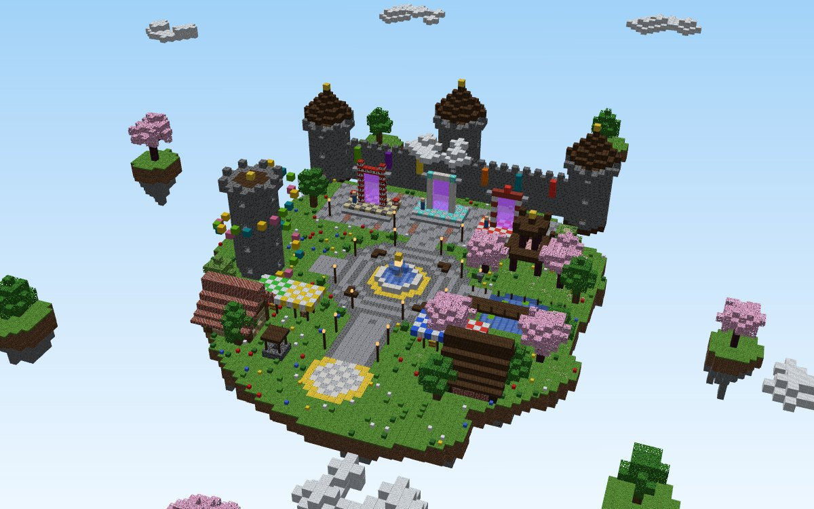

# 🧱 블록 아레나 (Block Arena)

마인크래프트 미니게임 서버 같은 **로블록스 게임**입니다.
로비에서 포털에 들어가 미니게임을 고르고, 대기실에서 맵을 투표한 뒤, 가장 많은 표를 받은 맵에서 게임을 합니다.

- **베드워즈**: 4팀. 침대가 남아 있으면 부활합니다. 생성기에서 철·금·다이아몬드·에메랄드를 모으고, 상점과 팀 강화를 이용합니다.
- **스카이워즈**: 8명. 유리관에서 시작해 상자에서 장비를 모읍니다. 마지막까지 살아남은 사람이 이깁니다.
- **TNT 런**: 밟은 블록(과 그 밑 TNT)이 곧 사라집니다. 더블 점프 3번으로 끝까지 버팁니다.

맵·건물·픽셀 텍스처·아이콘은 모두 이 프로젝트를 위해 새로 만든 것입니다.
마인크래프트의 실제 텍스처 파일이나 다른 서버의 맵은 쓰지 않았습니다(저작권 때문에).




## 바로 해 보기

1. [로블록스 스튜디오](https://create.roblox.com/)를 설치합니다.
2. `BlockArena.rbxlx` 를 더블클릭해서 엽니다 (또는 스튜디오에서 *파일 → 열기*).
3. 위쪽 **테스트 → 플레이** 를 누릅니다.
   - 스튜디오에서는 혼자서도 게임이 시작됩니다 (최소 인원 1명).
   - 여럿이 해 보려면 **테스트 → 클라이언트 및 서버 → 플레이어 2~4명 → 시작**.
4. 로비와 맵은 게임을 실행할 때 코드가 만들기 때문에 편집 화면에서는 비어 보이는 것이 정상입니다.

## 블록 텍스처

블록마다 16x16 픽셀 텍스처가 면마다 붙습니다(잔디 윗면/옆면, 원목 나이테, 양털 무늬, TNT 등 116종).

- **기본**: 게임이 시작될 때 텍스처를 코드로 직접 그려서(`EditableImage`) 붙입니다. 이미지를 올릴 필요가 없습니다.
- 텍스처가 안 보이고 색 블록으로만 보이면, 출력 창에 이유가 나옵니다. 보통 아래 둘 중 하나로 해결됩니다.
  1. *게임 설정 → 보안 → "메시/이미지 API 허용"* 을 켭니다 (게임을 공개할 때도 필요할 수 있습니다).
  2. 또는 `textures/` 폴더의 PNG 를 스튜디오 *에셋 관리자 → 일괄 가져오기* 로 올리고, 받은 ID 를 `src/shared/TextureIds.luau` 에
     `grass_top = "rbxassetid://숫자"` 처럼 적습니다. 적힌 것이 먼저 쓰입니다.
- 텍스처가 없어도 게임은 똑같이 돌아가고, 블록은 칸마다 색이 살짝 다른 색 블록으로 보입니다.
- 가벼움을 위해 카메라 가까이(약 130스터드)에 있는 블록의 **보이는 면에만** 텍스처를 붙입니다.
- 핫바와 가방의 블록 아이콘도 같은 텍스처를 또렷하게(Pixelated) 보여 줍니다.


## 로비

- 남쪽 **스폰 광장**과 큰길, 가판대와 집이 있는 **상점가**, 우물
- 가운데 **분수 광장**과 가로등, 벤치, 산울타리
- 북쪽 **게임 홀**: 미니게임마다 다르게 꾸민 **포털 3개**. 포털에 걸어 들어가면 바로 참가합니다. 옆 NPC(F 키), 나침반 우클릭으로도 참가할 수 있습니다.
  포털 위 안내판에 대기 인원과 게임 중 인원이 표시됩니다.
- 뒤쪽 **성벽과 탑 3개**, 미니게임 색 깃발
- 동쪽 **파쿠르 탑**: 빙글빙글 올라가는 발판 31개, 꼭대기에 도착하면 완주 메시지
- 서쪽 **정원**: 연못과 다리, 정자, 벚나무, 석등
- 스폰 옆 **승리 순위** 홀로그램(접속 중인 사람 기준), 둘레에 떠 있는 작은 섬과 구름

## 맵

| 모드 | 맵 | 특징 |
|---|---|---|
| 베드워즈 | 벚꽃 정원 | 벚나무 집, 석등, 도리이 문, 가운데 3단 지붕 정자, 연못 |
| 베드워즈 | 사막 신전 | 사암 평지붕 집, 야자수와 선인장, 기둥 신전, 오벨리스크, 오아시스, 먼 메사 |
| 베드워즈 | 얼음 성채 | 석재 벽돌 오두막과 눈 쌓인 지붕, 가문비나무, 얼음 가시, 가운데 탑 네 개, 먼 얼음산 |
| 스카이워즈 | 구름 정원 | 오두막(상자 안팎), 참나무/자작나무, 가운데 큰 나무와 나선 계단 전망대 |
| 스카이워즈 | 화산 군도 | 현무암 섬, 부서진 사당, 용암 웅덩이, 가운데 화산과 흑요석 기둥 |
| 스카이워즈 | 버섯 숲 | 버섯 집, 작은 거대버섯, 가운데 큰 버섯(아래 버섯 조명) |
| TNT 런 | 무지개 탑 | 무지개 바닥, 석영 기둥과 색유리 고리 |
| TNT 런 | 체스판 | 성 안 홀, 흑백 체스판 바닥, 벽 위 큰 체스 말, 깃발과 랜턴 |
| TNT 런 | 모래 폭포 | TNT 위에 깔린 모래/자갈 바닥, 협곡 절벽, 흘러내리는 모래 |

베드워즈 섬 구조: 앞쪽 침대 → 스폰 → 양옆 상점/강화 가판대(팀 색 천막) → 뒤쪽 자원 생성기 → 맨 뒤 팀 집(팀 색 깃발).

## 조작

| 키 | 동작 |
|---|---|
| 왼쪽 클릭 | 공격 / 꾹 누르면 블록 부수기 |
| 오른쪽 클릭 | 블록 놓기 / 아이템 사용 (활은 꾹 눌렀다 떼기) |
| 1~9, 마우스 휠 | 핫바 선택 |
| E | 가방 (갑옷 착용, 아이템 정리) |
| F | NPC·상자 열기 |
| Q | 손에 든 아이템 버리기 |
| Shift | 웅크리기 (가장자리에서 안 떨어짐) |
| Ctrl | 달리기 |
| 스페이스 (공중) | 더블 점프 (TNT 런) |
| V | 1인칭 / 3인칭 |
| L 두 번 | 로비로 돌아가기 |

모바일에서는 오른쪽에 공격·놓기·가방·시점·웅크림·로비·버리기 버튼이 생깁니다.

## 게임 흐름

로비 → (포털에 들어가기 / NPC 에게 F / 나침반 우클릭) → 대기실 → 맵 투표 (종이 아이템 우클릭) → 카운트다운 → 게임 → 결과 → 로비

- 최소 인원이 모이면 30초 카운트다운이 시작되고, 꽉 차면 10초로 줄어듭니다.
- 남은 시간이 4초가 되면 투표가 마감되고, 동점이면 무작위로 고릅니다.
- 경기장은 동시에 최대 10개까지 열립니다.

## 가볍게 만든 방법

- 사방이 막혀 안 보이는 블록은 파트를 만들지 않고 기록만 해 둡니다. 옆 블록이 부서져 드러나면 그때 파트를 만듭니다.
  (예: 로비는 블록 31,000개 중 실제 파트 12,000개, 베드워즈 맵은 7,000~11,000개)
- 멀리 있는 배경(메사, 얼음산, TNT 런의 벽/기둥)은 큰 파트 몇 개로 만들고 텍스처만 칸마다 반복합니다.

## 바꿔 보기

- `src/shared/Config.luau`: 인원, 카운트다운, 생성기 속도, 이벤트 시간, 이동 속도 같은 숫자
- `src/shared/Shop.luau`: 베드워즈 상점 가격과 팀 강화
- `src/server/Logic/Loot.luau`: 스카이워즈 상자에서 나오는 아이템
- `src/shared/Blocks.luau`: 블록 종류, 색, 단단함, 어떤 텍스처를 어느 면에 쓸지
- `src/shared/Textures.luau`: 픽셀 텍스처를 그리는 코드
- `src/server/Maps/`: 맵. 새 맵은 목록에 `{ id, name, description, seed, build }` 를 하나 더 넣으면 투표에 바로 나옵니다.
  `Shapes.luau` 에 섬, 나무(참나무·자작나무·벚나무·가문비나무·야자수), 집, 탑, 성벽, 도리이, 정자, 분수, 가판대, 울타리 같은 도구가 있습니다.

## 게임으로 공개할 때

- 승리/처치 기록은 DataStore 에 저장됩니다. 스튜디오에서도 저장하려면 *게임 설정 → 보안 → API 서비스에 대한 스튜디오 접근 허용*을 켭니다.
- 텍스처를 코드로 그리는 기능은 *게임 설정 → 보안 → 메시/이미지 API 허용*이 필요할 수 있습니다(위 "블록 텍스처" 참고).
- 아바타는 블록 모양 기본 캐릭터로 나옵니다 (`StarterPlayer.LoadCharacterAppearance = false`). 자기 아바타를 쓰려면 이 값을 켜세요.

## 개발용

코드는 [Rojo](https://rojo.space/) 프로젝트입니다.

```bash
cargo install rojo selene lune     # 처음 한 번
rojo serve                          # 스튜디오와 실시간 연결
scripts/build.sh                    # BlockArena.rbxlx 만들기 + 검사
```

`scripts/build.sh` 가 하는 일:

- `selene src`: 문법과 안 쓰는 변수 검사
- `lune run tests/run.luau BlockArena.rbxlx`: 플레이스 파일을 열어 모든 스크립트 컴파일, require 경로, 가방·투표·팀 나누기·상자·계산식 로직,
  텍스처 116종 생성, 숨은 블록 생략 규칙, 맵 9개·로비·대기실을 실제 Roblox 인스턴스 데이터로 만들어 보고
  스폰·침대·상자·NPC·포털 자리와 파쿠르 점프 거리, 파트 수를 확인
- `API_DUMP=API-Dump.json` 을 주면 `tests/api_check.py` 가 Roblox API 목록과 비교해 클래스·속성·메서드·Enum 이름을 확인

```
src/
  shared/      공용: 설정, 블록, 픽셀 텍스처, 아이템, 상점, 계산식, 아이콘
  server/      서버: 세션, 전투, 투사체, 폭발, 경기 관리, 로비, 상자
    Modes/     베드워즈, 스카이워즈, TNT 런 규칙
    Maps/      맵 생성 코드 (도구 Shapes, 로비, 대기실, 9개 맵)
    Logic/     로블록스 API 없이 테스트하는 순수 로직
  client/      화면(UI), 조작, 움직임, 효과, 블록 텍스처
  character/   기본 체력 회복을 끄는 스크립트
textures/      텍스처 PNG (직접 올려서 쓸 때)
docs/          미리보기 그림
```
