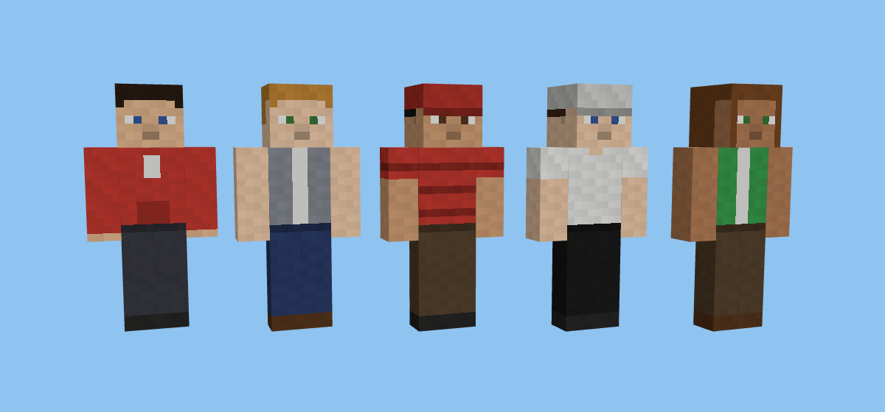
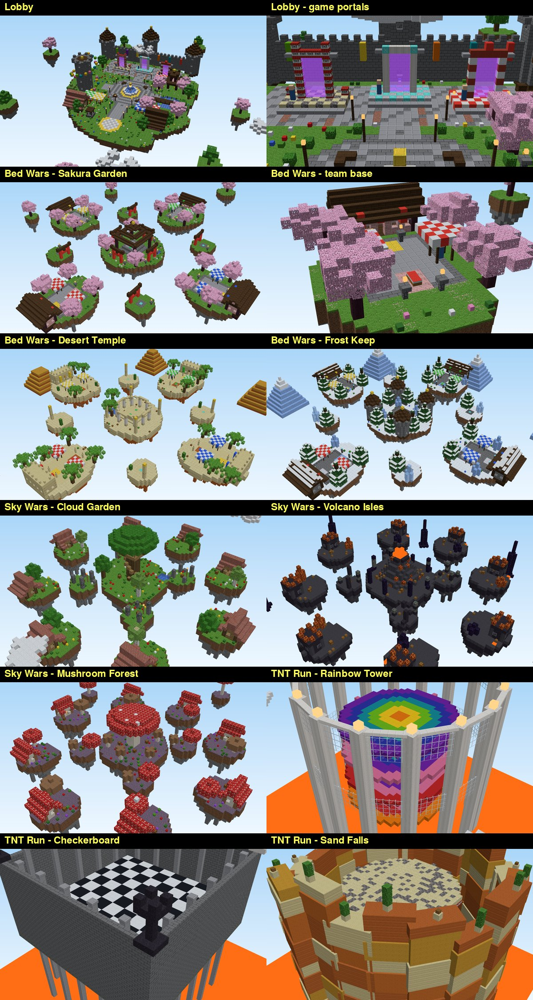
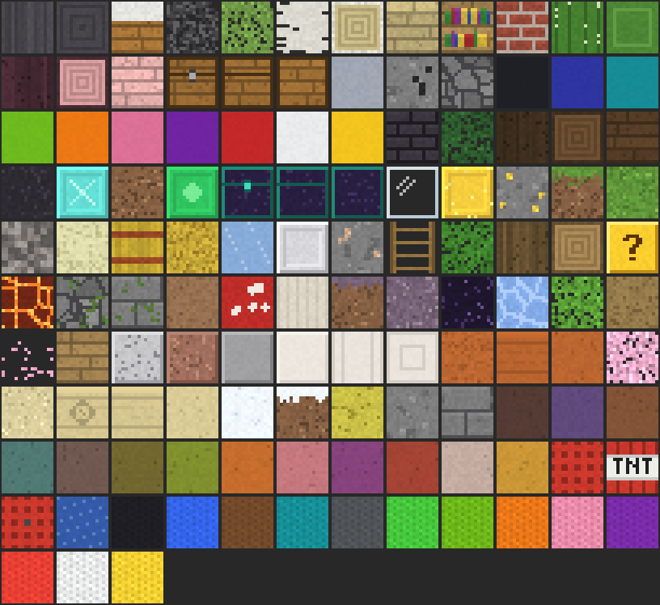

# 🧱 블록 아레나 (Block Arena)

마인크래프트 미니게임 서버 같은 **로블록스 게임**입니다.
로비에서 포털에 들어가 미니게임을 고르고, 대기실에서 맵을 투표한 뒤, 가장 많은 표를 받은 맵에서 게임을 합니다.

- **베드워즈**: 4팀. 침대가 남아 있으면 부활합니다. 생성기에서 철·금·다이아몬드·에메랄드를 모으고, 상점과 팀 강화·함정을 이용합니다.
  늦게까지 끝나지 않으면 침대가 모두 부서지고, 서든데스에는 팀마다 용이 나타납니다.
- **스카이워즈**: 8명. 키트와 능력을 고르고 유리관에서 시작해 상자와 럭키 블록에서 장비를 모읍니다. 마지막까지 살아남은 사람이 이깁니다.
- **TNT 런**: 밟은 블록(과 그 밑 TNT)이 곧 사라집니다. 더블 점프 3번으로 끝까지 버팁니다.

맵·건물·픽셀 텍스처·아이콘은 모두 이 프로젝트를 위해 새로 만든 것입니다.
마인크래프트의 실제 텍스처 파일이나 다른 서버의 맵은 쓰지 않았습니다(저작권 때문에).






## 바로 해 보기

1. [로블록스 스튜디오](https://create.roblox.com/)를 설치합니다.
2. `BlockArena.rbxlx` 를 더블클릭해서 엽니다 (또는 스튜디오에서 *파일 → 열기*).
3. 위쪽 **테스트 → 플레이** 를 누릅니다.
   - 스튜디오에서는 혼자서도 게임이 시작됩니다 (최소 인원 1명).
   - 여럿이 해 보려면 **테스트 → 클라이언트 및 서버 → 플레이어 2~4명 → 시작**.
4. 로비와 맵은 게임을 실행할 때 코드가 만들기 때문에 편집 화면에서는 비어 보이는 것이 정상입니다.

## 캐릭터와 스킨

- 모든 플레이어가 **블록 캐릭터**로 나옵니다: 정육면체 머리, 얇은 몸통, 네모난 팔다리(픽셀 비율 8/12/4).
  걸을 때 팔다리를 앞뒤로 흔들고, 공격·블록 설치 때 오른팔을 휘두릅니다.
- 몸 여섯 부위의 모든 면에 픽셀 스킨이 그려집니다. 기본 스킨은 이 게임의 오리지널 디자인(빨간 후드, 검은 머리)입니다.
- 입은 갑옷이 몸 위에 보입니다. 베드워즈 가죽 갑옷은 팀 색으로 물들어서 팀을 구분할 수 있습니다.
- **스킨 꾸미기(왼쪽 위 '스킨')**: 피부·머리카락·눈·옷·바지·신발 색, 머리 모양 4가지, 옷 모양 4가지, 프리셋 5가지(기본, 기사, 해적, 요리사, 숲 탐험가).
  입어 보기는 누구나 되고, **저장하려면 커스텀 스킨 패스(67 로벅스)** 가 필요합니다. 기본 스킨으로 되돌리는 건 무료입니다.

## VIP 와 상점 (왼쪽 위 '상점')

| 상품 | 가격 | 혜택 |
|---|---|---|
| VIP 패키지 | 199 로벅스 (바꿀 수 있음) | 로비에서 날기, 이름표와 채팅에 금색 [VIP] 칭호, 게임 전에 원하는 맵 고르기 |
| 커스텀 스킨 | 67 로벅스 | 스킨 꾸미기 저장 |

- **날기**: 로비에서 스페이스를 빠르게 두 번 누르면 날고, 다시 두 번 누르면 내려옵니다. 날 때 스페이스는 위, Shift(또는 Ctrl)는 아래입니다.
  모바일은 설정 탭의 "지금 날기 / 내려오기" 버튼을 씁니다. 로비를 떠나면 자동으로 내려옵니다.
- **맵 고르기**: 맵은 기본적으로 **무작위**입니다. 대기실에서 VIP 만 맵을 고를 수 있고, VIP 가 여럿이면 VIP 끼리 투표합니다.

### 게임패스 만들기 (게임을 공개할 때 한 번)

1. 게임을 로블록스에 게시합니다.
2. [크리에이터 대시보드](https://create.roblox.com/) → 내 게임 → **수익 창출 → 패스** 에서 패스 두 개(VIP 패키지, 커스텀 스킨)를 만들고 판매를 켭니다.
   가격은 여기서 정합니다(커스텀 스킨 67, VIP 는 원하는 값).
3. 각 패스의 숫자 ID 를 `src/shared/Config.luau` 의 `Config.Passes.vip.id`, `Config.Passes.skin.id` 에 적습니다.
4. 상점 화면의 가격은 대시보드에 적힌 실제 가격을 자동으로 가져옵니다.

패스 ID 를 적기 전에도 **스튜디오에서는** 상점의 "구매 (스튜디오 시험)" 버튼으로 바로 받아서 VIP 와 스킨 기능을 시험해 볼 수 있습니다
(실제 게임에서는 ID 가 없으면 "준비 중"으로 보입니다). 스튜디오 시험 구매는 저장되지 않습니다.

## 설정 (왼쪽 위 '설정')

시점(1인칭/3인칭), 블록 텍스처 켜기/끄기, 텍스처 거리(가까이/보통/멀리), 효과음, 다른 사람 이름표, 게임 알림 채팅, VIP 날기.
바꾸면 바로 적용되고 계정에 저장됩니다.

## 블록 텍스처

블록마다 16x16 픽셀 텍스처가 면마다 붙습니다(잔디 윗면/옆면, 원목 나이테, 양털 무늬, TNT, 사다리, 럭키 블록 등 123종).

- **기본**: 게임이 시작될 때 텍스처를 코드로 직접 그려서(`EditableImage`) 붙입니다. 이미지를 올릴 필요가 없습니다.
- 텍스처가 안 보이고 색 블록으로만 보이면, 출력 창에 이유가 나옵니다. 보통 아래 둘 중 하나로 해결됩니다.
  1. *게임 설정 → 보안 → "메시/이미지 API 허용"* 을 켭니다 (게임을 공개할 때도 필요할 수 있습니다).
  2. 또는 `textures/` 폴더의 PNG 를 스튜디오 *에셋 관리자 → 일괄 가져오기* 로 올리고, 받은 ID 를 `src/shared/TextureIds.luau` 에
     `grass_top = "rbxassetid://숫자"` 처럼 적습니다. 적힌 것이 먼저 쓰입니다.
- 텍스처가 없어도 게임은 똑같이 돌아가고, 블록은 칸마다 색이 살짝 다른 색 블록으로 보입니다.
- 가벼움을 위해 카메라 가까이(약 130스터드)에 있는 블록의 **보이는 면에만** 텍스처를 붙입니다.
- 핫바와 가방의 블록 아이콘도 같은 텍스처를 또렷하게(Pixelated) 보여 줍니다.



## 로비

- 남쪽 **스폰 광장**과 큰길, 가판대와 집이 있는 **상점가**, 우물
- 가운데 **분수 광장**과 가로등, 벤치, 산울타리
- 북쪽 **게임 홀**: 미니게임마다 다르게 꾸민 **포털 3개**. 포털에 걸어 들어가면 바로 참가합니다. 옆 NPC(F 키), 나침반 우클릭으로도 참가할 수 있습니다.
  포털 위 안내판에 대기 인원과 게임 중 인원이 표시됩니다.
- 뒤쪽 **성벽과 탑 3개**, 미니게임 색 깃발
- 동쪽 **파쿠르 탑**: 빙글빙글 올라가는 발판 31개, 꼭대기에 도착하면 완주 메시지
- 서쪽 **정원**: 연못과 다리, 정자, 벚나무, 석등
- 스폰 옆 **승리 순위** 홀로그램(접속 중인 사람 기준), 둘레에 떠 있는 작은 섬과 구름

## 맵

| 모드 | 맵 | 특징 |
|---|---|---|
| 베드워즈 | 벚꽃 정원 | 벚나무 집, 석등, 도리이 문, 가운데 3단 지붕 정자, 연못 |
| 베드워즈 | 사막 신전 | 사암 평지붕 집, 야자수와 선인장, 기둥 신전, 오벨리스크, 오아시스, 먼 메사 |
| 베드워즈 | 얼음 성채 | 석재 벽돌 오두막과 눈 쌓인 지붕, 가문비나무, 얼음 가시, 가운데 탑 네 개, 먼 얼음산 |
| 스카이워즈 | 구름 정원 | 오두막(상자 안팎), 참나무/자작나무, 가운데 큰 나무와 나선 계단 전망대 |
| 스카이워즈 | 화산 군도 | 현무암 섬, 부서진 사당, 용암 웅덩이, 가운데 화산과 흑요석 기둥 |
| 스카이워즈 | 버섯 숲 | 버섯 집, 작은 거대버섯, 가운데 큰 버섯(아래 버섯 조명) |
| TNT 런 | 무지개 탑 | 무지개 바닥, 석영 기둥과 색유리 고리 |
| TNT 런 | 체스판 | 성 안 홀, 흑백 체스판 바닥, 벽 위 큰 체스 말, 깃발과 랜턴 |
| TNT 런 | 모래 폭포 | TNT 위에 깔린 모래/자갈 바닥, 협곡 절벽, 흘러내리는 모래 |

베드워즈 섬 구조: 앞쪽 침대 → 스폰 → 양옆 상점/강화 가판대(팀 색 천막) → 팀 상자·개인 상자 → 뒤쪽 자원 생성기 → 맨 뒤 팀 집(팀 색 깃발).

## 베드워즈 상점과 팀 강화

아이템 상점(F)은 탭 8개, 한 탭에 두 줄(18칸)까지 보입니다. 첫 탭 **빠른 구매**에는 자주 사는 물건 18개가 모여 있습니다.

| 탭 | 물건 |
|---|---|
| 블록 | 양털, 단단한 점토, 방폭 유리, 강화 석재(폭발에 강함), 사다리, 판자, 흑요석 |
| 근접 무기 | 돌/철/다이아몬드 검, 넉백 막대기 |
| 갑옷 | 사슬/철/다이아몬드 갑옷 (영구) |
| 도구 | 가위(영구), 곡괭이·도끼 (살 때마다 한 단계, 죽으면 한 단계 내려감) |
| 원거리 | 화살, 활, 힘 마법 활, 힘+밀치기 마법 활, 눈덩이 |
| 물약 | 신속(45초), 도약(45초), 투명화(30초, 공격하면 풀림) |
| 유틸리티 | 황금 사과, 좀벌레 알, 수호 골렘, 화염구, TNT, 순간이동 진주, 물 양동이, 다리 알, 마법 우유, 스펀지, 팝업 타워 |

- **물 양동이**: 블록처럼 놓으면 물이 생기고 아래로 흘러내립니다. 물에 떨어지면 낙하 피해가 없고, 물 근처에서 터진 TNT·화염구는 블록을 못 부숩니다.
- **스펀지**: 놓으면 주변 3칸의 물·용암을 빨아들입니다.
- **사다리**: 벽에 붙여 놓고 앞으로 가거나 점프하면 올라갑니다(웅크리면 멈춤).
- **다리 알**: 던지면 날아간 길 아래에 팀 양털이 두 줄로 깔립니다.
- **팝업 타워**: 그 자리에 사다리가 달린 양털 탑과 난간 있는 발판이 한 번에 세워집니다.
- **수호 골렘**: 4분 동안 기지 근처의 적을 쫓아가 때립니다. **좀벌레 알**: 떨어진 곳에 15초 동안 적을 무는 좀벌레가 나옵니다. 몹도 때리거나 화살·폭발로 잡을 수 있습니다.
- **팀 상자**(같은 팀만)와 **개인 상자**(어느 섬의 개인 상자에서 열어도 내 것)가 섬마다 있습니다.

팀 강화 NPC(다이아몬드):

| 강화 | 단계 | 효과 |
|---|---|---|
| 날카로운 검 | 1 | 팀 검 공격력 +1 |
| 강화 갑옷 | 4 | 단계마다 받는 피해 6% 감소 |
| 광부의 손 | 2 | 블록 부수는 속도 +25% / +50% |
| 강화 용광로 | 4 | 철·금 +50% → +100% → 섬에서 에메랄드 → +200% |
| 치유의 샘 | 1 | 기지 근처에서 체력이 빨리 참 |
| 용의 가호 | 1 | 서든데스 때 우리 팀 용 +1 |

**함정**은 최대 3개까지 줄을 세울 수 있고(가격 1 → 2 → 4 다이아몬드), 적이 기지에 들어오면 맨 앞 함정부터 하나씩 발동합니다.
경보(투명화 풀기 + 알림), 피로(10초 동안 아주 느리게 부숨), 어둠(8초 동안 화면이 어둡고 느려짐), 반격(우리 팀 15초 신속·도약).
마법 우유를 마시면 30초 동안 함정에 걸리지 않습니다.

시간 이벤트: 5분 다이아 II → 10분 에메랄드 II → 15분 다이아 III → 20분 에메랄드 III → 25분 모든 침대 파괴 → 30분 서든데스(팀마다 용) → 40분 게임 종료.

## 스카이워즈 키트·능력·럭키 블록

대기실에서 상자 아이템(2번 칸)을 우클릭하면 **키트**와 **능력**을 고릅니다. 키트 아이템은 유리관이 열릴 때 받습니다.

- 키트 10개: 탐험가, 기사, 궁수, 건축가, 광부, 치유사, 낚시꾼, 폭파병, 용암술사, 점프왕
- 능력 6개: 처치 회복, 화살 회수, 깃털 낙하, 단단한 몸, 행운의 곡괭이, 보호막
- 상자에는 날카로움 검, 보호 갑옷, 힘·밀치기 활, 넉백 막대기, 물·용암 양동이, 낚싯대, 물약도 나옵니다.
- **럭키 블록**: 섬 곳곳에 확률로 놓입니다. 부수면 좋은 장비가 튀어나오거나, 불붙은 TNT·좀벌레 떼·어둠·번개·하늘로 날아가기 같은 나쁜 일이 생깁니다.
- **낚싯대**: 맞힌 사람을 내 쪽으로 끌어당깁니다. **용암 양동이**: 닿으면 불이 붙고, 물에 들어가면 꺼집니다.

## 조작

| 키 | 동작 |
|---|---|
| 왼쪽 클릭 | 공격 / 꾹 누르면 블록 부수기 |
| 오른쪽 클릭 | 블록·양동이·타워·골렘 놓기 / 아이템 사용 (물약 마시기, 낚싯대·알 던지기, 활은 꾹 눌렀다 떼기) |
| 1~9, 마우스 휠 | 핫바 선택 |
| E | 가방 (갑옷 착용, 아이템 정리) |
| F | NPC·상자(팀 상자, 개인 상자) 열기 |
| Q | 손에 든 아이템 버리기 |
| Shift | 웅크리기 (가장자리에서 안 떨어짐) |
| Ctrl | 달리기 |
| 스페이스 (공중) | 더블 점프 (TNT 런) / 물에서 떠오르기 / 사다리 오르기 |
| V | 1인칭 / 3인칭 |
| 스페이스 두 번 (로비, VIP) | 날기 켜기/끄기 |
| L 두 번 | 로비로 돌아가기 |

모바일에서는 오른쪽에 공격·놓기·가방·시점·웅크림·로비·버리기 버튼이 생깁니다.

## 게임 흐름

로비 → (포털에 들어가기 / NPC 에게 F / 나침반 우클릭) → 대기실 → (VIP 는 종이 아이템으로 맵 고르기) → 카운트다운 → 게임 → 결과 → 로비

- 최소 인원이 모이면 30초 카운트다운이 시작되고, 꽉 차면 10초로 줄어듭니다.
- 맵은 무작위입니다. VIP 가 고르면 그 맵(여럿이면 VIP 끼리 다수결, 동점이면 무작위)으로 정해지고, 남은 시간이 4초일 때 확정됩니다.
- 경기장은 동시에 최대 10개까지 열립니다.

## 가볍게 만든 방법

- 사방이 막혀 안 보이는 블록은 파트를 만들지 않고 기록만 해 둡니다. 옆 블록이 부서져 드러나면 그때 파트를 만듭니다.
  (예: 로비는 블록 31,000개 중 실제 파트 12,000개, 베드워즈 맵은 7,000~11,000개)
- 멀리 있는 배경(메사, 얼음산, TNT 런의 벽/기둥)은 큰 파트 몇 개로 만들고 텍스처만 칸마다 반복합니다.

## 바꿔 보기

- `src/shared/Config.luau`: 인원, 카운트다운, 생성기 속도, 이벤트 시간, 이동 속도 같은 숫자
- `src/shared/Shop.luau`: 베드워즈 상점 가격, 빠른 구매 목록, 팀 강화, 함정
- `src/shared/Kits.luau`: 스카이워즈 키트와 능력
- `src/server/Logic/Loot.luau`: 스카이워즈 상자에서 나오는 아이템
- `src/server/Logic/LuckyTable.luau`: 럭키 블록 결과와 확률
- `Config.Mobs`, `Config.Effects`: 골렘·좀벌레·용의 체력/공격력/속도, 물약 효과 배율
- `src/shared/Blocks.luau`: 블록 종류, 색, 단단함, 어떤 텍스처를 어느 면에 쓸지
- `src/shared/Textures.luau`: 픽셀 텍스처를 그리는 코드
- `src/server/Maps/`: 맵. 새 맵은 목록에 `{ id, name, description, seed, build }` 를 하나 더 넣으면 투표에 바로 나옵니다.
  `Shapes.luau` 에 섬, 나무(참나무·자작나무·벚나무·가문비나무·야자수), 집, 탑, 성벽, 도리이, 정자, 분수, 가판대, 울타리 같은 도구가 있습니다.

## 게임으로 공개할 때

- 승리/처치 기록은 DataStore 에 저장됩니다. 스튜디오에서도 저장하려면 *게임 설정 → 보안 → API 서비스에 대한 스튜디오 접근 허용*을 켭니다.
- 텍스처를 코드로 그리는 기능은 *게임 설정 → 보안 → 메시/이미지 API 허용*이 필요할 수 있습니다(위 "블록 텍스처" 참고).
- 게임패스 설정은 위 "게임패스 만들기"를 따라 하세요.

## 개발용

코드는 [Rojo](https://rojo.space/) 프로젝트입니다.

```bash
cargo install rojo selene lune     # 처음 한 번
rojo serve                          # 스튜디오와 실시간 연결
scripts/build.sh                    # BlockArena.rbxlx 만들기 + 검사
```

`scripts/build.sh` 가 하는 일:

- `selene src`: 문법과 안 쓰는 변수 검사
- `lune run tests/run.luau BlockArena.rbxlx`: 플레이스 파일을 열어 모든 스크립트 컴파일, require 경로, 가방·투표·팀 나누기·상자·계산식 로직,
  텍스처 123종 생성, 숨은 블록 생략 규칙, 사다리 방향, 몹 걷기(턱 오르기·벽에서 멈춤·착지), 상점·강화·함정·키트·럭키 블록 표,
  맵 9개·로비·대기실을 실제 Roblox 인스턴스 데이터로 만들어 보고 스폰·침대·팀 상자·상자·럭키 블록·NPC·포털 자리와
  파쿠르 점프 거리, 파트 수를 확인
- `API_DUMP=API-Dump.json` 을 주면 `tests/api_check.py` 가 Roblox API 목록과 비교해 클래스·속성·메서드·Enum 이름을 확인

```
src/
  shared/      공용: 설정, 블록, 픽셀 텍스처, 아이템, 상점, 계산식, 아이콘, 스킨, 캐릭터 몸, 설정 항목
  server/      서버: 세션, 전투, 투사체, 폭발, 상태 효과, 몹(골렘·좀벌레·용), 럭키 블록, 경기 관리, 로비, 상자
    Modes/     베드워즈, 스카이워즈, TNT 런 규칙
    Maps/      맵 생성 코드 (도구 Shapes, 로비, 대기실, 9개 맵)
    Logic/     로블록스 API 없이 테스트하는 순수 로직
  client/      화면(UI), 조작, 움직임, 효과, 블록 텍스처, 캐릭터 꾸미기/애니메이션, VIP 날기
  character/   기본 체력 회복과 기본 애니메이션을 끄는 스크립트
textures/      텍스처 PNG (직접 올려서 쓸 때)
docs/          미리보기 그림
```
