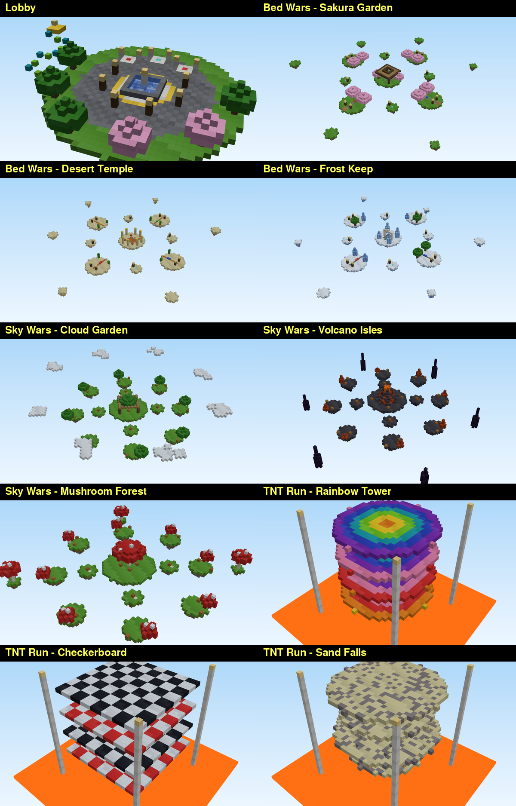

# 🧱 블록 아레나 (Block Arena)

마인크래프트 미니게임 서버 같은 **로블록스 게임**입니다.
로비에서 미니게임을 고르고, 대기실에서 맵을 투표한 뒤, 가장 많은 표를 받은 맵에서 게임을 합니다.

- **베드워즈**: 4팀. 침대가 남아 있으면 부활합니다. 생성기에서 철·금·다이아몬드·에메랄드를 모으고, 상점과 팀 강화를 이용합니다.
- **스카이워즈**: 8명. 유리관에서 시작해 상자에서 장비를 모읍니다. 마지막까지 살아남은 사람이 이깁니다.
- **TNT 런**: 밟은 블록이 곧 사라집니다. 더블 점프 3번으로 끝까지 버팁니다.

맵·이름·아이콘은 모두 이 프로젝트를 위해 새로 만들었고, 마인크래프트나 다른 서버의 그림·텍스처는 쓰지 않았습니다.



## 바로 해 보기

1. [로블록스 스튜디오](https://create.roblox.com/)를 설치합니다.
2. `BlockArena.rbxlx` 를 더블클릭해서 엽니다 (또는 스튜디오에서 *파일 → 열기*).
3. 위쪽 **테스트 → 플레이** 를 누릅니다.
   - 스튜디오에서는 혼자서도 게임이 시작됩니다 (최소 인원 1명).
   - 여럿이 해 보려면 **테스트 → 클라이언트 및 서버 → 플레이어 2~4명 → 시작**.
4. 맵은 게임을 실행할 때 코드가 만들기 때문에 편집 화면에서는 비어 보이는 것이 정상입니다.

## 조작

| 키 | 동작 |
|---|---|
| 왼쪽 클릭 | 공격 / 꾹 누르면 블록 부수기 |
| 오른쪽 클릭 | 블록 놓기 / 아이템 사용 (활은 꾹 눌렀다 떼기) |
| 1~9, 마우스 휠 | 핫바 선택 |
| E | 가방 (갑옷 착용, 아이템 정리) |
| F | NPC·상자 열기 |
| Q | 손에 든 아이템 버리기 |
| Shift | 웅크리기 (가장자리에서 안 떨어짐) |
| Ctrl | 달리기 |
| 스페이스 (공중) | 더블 점프 (TNT 런) |
| V | 1인칭 / 3인칭 |
| L 두 번 | 로비로 돌아가기 |

모바일에서는 오른쪽에 공격·놓기·가방·시점·웅크림·로비·버리기 버튼이 생깁니다.

## 게임 흐름

로비 → (NPC 앞에서 F 또는 나침반 우클릭) → 대기실 → 맵 투표 (종이 아이템 우클릭) → 카운트다운 → 게임 → 결과 → 로비

- 최소 인원이 모이면 30초 카운트다운이 시작되고, 꽉 차면 10초로 줄어듭니다.
- 남은 시간이 4초가 되면 투표가 마감되고, 동점이면 무작위로 고릅니다.
- 경기장은 동시에 최대 10개까지 열립니다.

## 마인크래프트 느낌

- 블록 한 칸 = 3스터드. 1칸은 점프로 올라가고 2칸은 못 올라갑니다.
- 체력은 하트 10개, 갑옷 점수 1당 피해 4% 감소, 맞으면 잠깐 무적, 떨어지면 치명타.
- 회색 입체 창, 움푹 들어간 아이템 칸, 그림자 글씨, 오른쪽 점수판, 가운데 큰 제목, 픽셀 아이콘 (직접 그림).
- 블록마다 색을 살짝 다르게 해서 픽셀 느낌을 냅니다.

## 바꿔 보기

- `src/shared/Config.luau`: 인원, 카운트다운, 생성기 속도, 이벤트 시간, 이동 속도 같은 숫자
- `src/shared/Shop.luau`: 베드워즈 상점 가격과 팀 강화
- `src/server/Logic/Loot.luau`: 스카이워즈 상자에서 나오는 아이템
- `src/shared/Blocks.luau`: 블록 색과 단단함. `textureId = "rbxassetid://..."` 를 넣으면 직접 올린 픽셀 텍스처를 블록에 붙입니다
- `src/server/Maps/`: 맵. 새 맵은 목록에 `{ id, name, description, seed, build }` 를 하나 더 넣으면 투표에 바로 나옵니다

## 게임으로 공개할 때

- 승리/처치 기록은 DataStore 에 저장됩니다. 스튜디오에서도 저장하려면 *게임 설정 → 보안 → API 서비스에 대한 스튜디오 접근 허용*을 켭니다.
- 아바타는 블록 모양 기본 캐릭터로 나옵니다 (`StarterPlayer.LoadCharacterAppearance = false`). 자기 아바타를 쓰려면 이 값을 켜세요.

## 개발용

코드는 [Rojo](https://rojo.space/) 프로젝트입니다.

```bash
cargo install rojo selene lune     # 처음 한 번
rojo serve                          # 스튜디오와 실시간 연결
scripts/build.sh                    # BlockArena.rbxlx 만들기 + 검사
```

`scripts/build.sh` 가 하는 일:

- `selene src`: 문법과 안 쓰는 변수 검사
- `lune run tests/run.luau BlockArena.rbxlx`: 플레이스 파일을 열어 모든 스크립트 컴파일, require 경로, 가방·투표·팀 나누기·상자·계산식 로직, 맵 9개와 로비를 실제 Roblox 인스턴스 데이터로 만들어 보고 스폰·침대·상자·NPC 자리가 맞는지 확인
- `API_DUMP=API-Dump.json` 을 주면 `tests/api_check.py` 가 Roblox API 목록과 비교해 클래스·속성·메서드·Enum 이름을 확인

```
src/
  shared/      공용: 설정, 블록, 아이템, 상점, 계산식, 픽셀 아이콘
  server/      서버: 세션, 전투, 투사체, 폭발, 경기 관리, 로비, 상자
    Modes/     베드워즈, 스카이워즈, TNT 런 규칙
    Maps/      맵 생성 코드 (로비, 대기실, 9개 맵)
    Logic/     로블록스 API 없이 테스트하는 순수 로직
  client/      화면(UI), 조작, 움직임, 효과
  character/   기본 체력 회복을 끄는 스크립트
```
